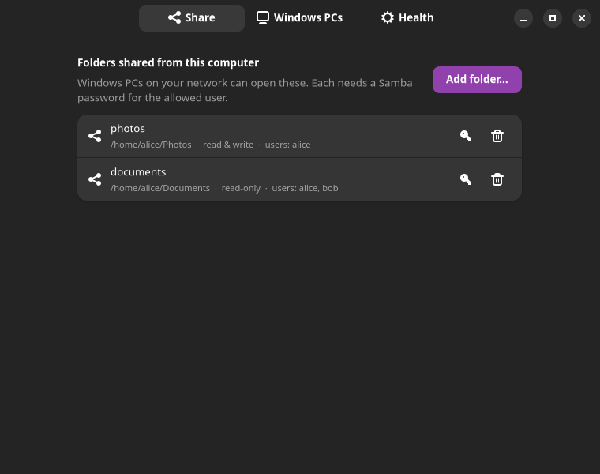
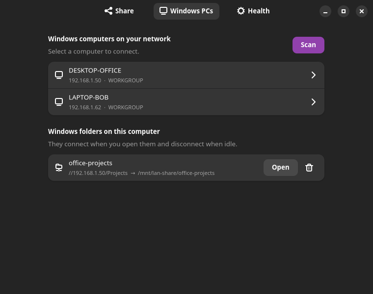
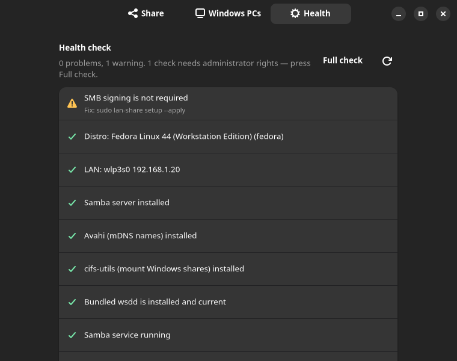
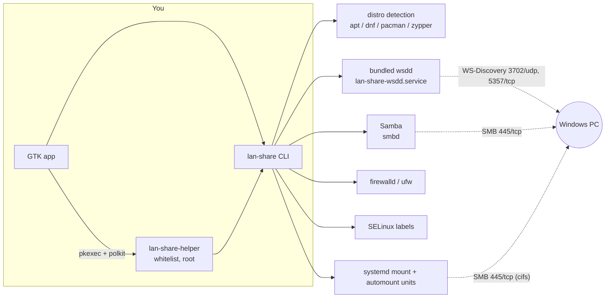

# linux-windows-network-access (`lan-share`)

Make a Linux computer show up in **Windows Explorer's Network tab** and serve files to Windows, and open **Windows shared folders on Linux** — on mainstream systemd distributions, from a command line or a small desktop app.

Windows 10/11 no longer discovers Linux machines by itself (SMB1/NetBIOS browsing is gone). A Linux box only appears in the Network tab if it speaks *WS-Discovery*, and only works with modern, signed, authenticated SMB. `lan-share` wires the existing pieces together (Samba, WS-Discovery, the firewall, SELinux, mounts), keeps them locked down to your LAN, and tells you what is wrong when something does not work.

| Share | Windows PCs | Health |
|:---:|:---:|:---:|
|  |  |  |

<sub>Screenshots are rendered from the real window with demo data (`tools/screenshots.py`), not from a real network.</sub>

---

## Contents

- [What you get](#what-you-get)
- [Quick start](#quick-start)
- [Install](#install)
- [Using it](#using-it) — [command line](#command-line) · [graphical app](#graphical-app) · [Windows side](#windows-side-checklist)
- [How it works](#how-it-works)
- [Security model](#security-model)
- [What has been tested](#what-has-been-tested)
- [Troubleshooting](#troubleshooting)
- [Uninstall](#uninstall)
- [Development](#development)
- [Known limitations](#known-limitations)
- [License and third-party code](#license-and-third-party-code)

## What you get

**Linux → Windows** (this computer appears in Windows' *Network* tab and serves folders):
- Samba file server configured for SMB2/3 only, signing required, no guest access, bound to your LAN interface only.
- WS-Discovery announcements (a bundled copy of [`wsdd`](https://github.com/christgau/wsdd)) so Explorer lists the machine.
- Firewall rules (firewalld or ufw) restricted to your LAN, SELinux labels for the shared folders, and the services enabled.

**Windows → Linux** (Windows shared folders open on this computer):
- `scan` finds Windows machines on the LAN; `shares` lists a PC's folders.
- `mount` connects a Windows folder at `/mnt/lan-share/<name>`, **on first access** (systemd automount), and disconnects when idle — so a sleeping PC never blocks boot or hangs your file manager.

**Around it:**
- `doctor` — checks the whole chain and prints a fix for each problem.
- `teardown` — undoes what `setup` added, and only that.
- A GTK 4 / libadwaita app with the same features.
- `setup` and `teardown` are dry runs: they print every change they would make until you add `--apply`.

## Quick start

```bash
# 1. install (see "Install" for rpm / Arch / other)
sudo apt install ./lan-share_0.1.0_all.deb

# 2. share a folder with a Windows PC
lan-share share add photos ~/Photos --user "$USER" --rw   # needs root to save; or use the GUI
lan-share setup                      # DRY RUN: shows exactly what will change
sudo lan-share setup --apply         # installs Samba, writes config, opens the firewall, starts services
sudo lan-share user add "$USER"      # set the Samba password Windows will ask for

# 3. on Windows: Explorer -> Network -> your computer -> photos   (or \\your-hostname\photos)

# 4. open a Windows folder on Linux
lan-share scan                                   # find the PC
lan-share shares 192.168.1.50 --user alice       # list what it shares
sudo lan-share mount add office //192.168.1.50/Projects --user alice
ls /mnt/lan-share/office                         # connects on first access

# anything wrong?
lan-share doctor
```

## Install

Download from the [Releases](https://github.com/balojr/linux-windows-network-access/releases) page. Each release has a `SHA256SUMS` file; verify with `sha256sum -c SHA256SUMS`. The packages are **unsigned**.

| Distribution | File | Command |
|---|---|---|
| Debian, Ubuntu, Mint… | `lan-share_<ver>_all.deb` | `sudo apt install ./lan-share_<ver>_all.deb` |
| Fedora, RHEL / Rocky / Alma | `lan-share-<ver>-1.noarch.rpm` | `sudo dnf install ./lan-share-<ver>-1.noarch.rpm` |
| openSUSE | the same `.rpm` | `sudo zypper --no-gpg-checks install ./lan-share-<ver>-1.noarch.rpm` |
| Arch, Manjaro… | `lan-share-<ver>-1-any.pkg.tar.zst` | `sudo pacman -U ./lan-share-<ver>-1-any.pkg.tar.zst` |
| Anything else | `lan-share-<ver>.tar.gz` | `tar xzf …; cd lan-share-<ver>; sudo ./packaging/install.sh install` |

Requirements: `python3` ≥ 3.9 and systemd. Nothing else — `lan-share setup` installs Samba, Avahi and cifs-utils itself using your distribution's package manager. `PREFIX=/usr/local ./packaging/install.sh install` installs outside `/usr`; `./packaging/install.sh uninstall` removes the files.

**The graphical app** additionally needs GTK 4 and **libadwaita 1.5 or newer** for Python (`python3-gi`/`python3-gobject`, GTK 4 and libadwaita typelibs) and `polkit`/`pkexec`:

| Works | Does not (too old — use the command line) |
|---|---|
| Ubuntu 24.04+, Debian 13+, Fedora, Arch, openSUSE | Ubuntu 22.04, Debian 12, RHEL/Rocky 9 (libadwaita < 1.5) |

The `.deb` and `.rpm` list the GUI libraries as *recommended* packages. Arch lists them as optional dependencies, and zypper does not install recommended packages for a local rpm, so on those install them yourself, e.g. `sudo zypper install python313-gobject typelib-1_0-Gtk-4_0 typelib-1_0-Adw-1` (match the Python flavour on your system). If something is missing, `lan-share gui` says exactly what.

## Using it

### Command line

`setup` and `teardown` are **dry runs** until you pass `--apply`. The others act when you run them: `mount add` / `mount remove` and `user add` take effect immediately, and `share add` / `share remove` only save your configuration (nothing goes live) unless you add `--apply`. All of them except read-only ones need root.

| Command | What it does |
|---|---|
| `lan-share detect` | Distribution, what is installed, LAN interfaces found |
| `lan-share share add NAME PATH --user U [--user U2] [--rw] [--apply]` | Add a shared folder (read-only unless `--rw`); `--apply` also runs `setup` |
| `lan-share share list` / `share remove NAME [--apply]` | List / remove shared folders |
| `lan-share setup [--apply] [--interface IF] [--zone Z] [--allow-untrusted-zone]` | Install and configure everything for the saved shares |
| `lan-share user add NAME` | Set the Samba password for an existing Linux user (Samba keeps its own password database) |
| `lan-share scan [--timeout S] [--json]` | Find Windows machines (WS-Discovery) |
| `lan-share shares HOST --user U [--domain D]` | List the folders a Windows PC shares (asks for the password) |
| `lan-share mount add NAME //HOST/SHARE --user U [--domain D]` | Connect a Windows folder at `/mnt/lan-share/NAME` (on first access) |
| `lan-share mount list` / `mount remove NAME` | List / disconnect and forget |
| `lan-share doctor [--json]` | Diagnose problems; run with `sudo` (or the GUI's *Full check*) for the root-only checks |
| `lan-share teardown [--apply] [--keep-mounts] [--purge]` | Undo `setup` (see [Uninstall](#uninstall)) |
| `lan-share render` | Print the Samba config that would be written |
| `lan-share gui` | Open the graphical app |

Notes:
- For a **Microsoft account** on the Windows PC, the username is the account's e-mail address.
- Use the PC's **IP address** for mounts; Windows computer names often don't resolve on Linux. If the IP changes, `scan` finds it again.
- `--root DIR` stages file writes into a scratch directory and skips all commands — handy for reviewing what `setup` would write.

### Graphical app

`lan-share gui`, or **LAN Share** in your application menu. Three tabs:

- **Share** — add a folder (pick it, name it, choose who may open it and whether they may change files), remove it, and set the Samba password (key icon).
- **Windows PCs** — **Scan**, pick a computer, sign in, choose one of its folders, **Connect**; later **Open** or disconnect it.
- **Health** — the `doctor` checks, problems first. **Full check** also runs the checks that need administrator rights.

The app itself never runs as root. Changes go through `pkexec` to a small helper (`/usr/lib/lan-share/lan-share-helper`) with its own polkit policy, so the prompt reads *"Authentication is required to change file sharing settings on this computer"* and polkit can remember the authorization for a few minutes. Passwords are piped to the command line tool's standard input; they never appear in a process list. Running from a source checkout (no helper installed) falls back to a generic `pkexec` prompt.

### Windows side checklist

These cannot be checked from Linux. If the computer does not appear in Explorer's **Network** tab:

1. The network profile is **Private**, not Public (*Settings → Network & internet → your connection*).
2. **Network discovery** is on (*Control Panel → Network and Sharing Center → Advanced sharing settings*).
3. The services **Function Discovery Resource Publication** and **SSDP Discovery** are running (`services.msc`).
4. To let Linux open a Windows folder: **File and printer sharing** is on, the folder is shared to your account, and you use that account's real username and password.

If `\\<linux-ip>\<share>` works but the Network tab does not list the machine, the problem is discovery (items 1–3), not file sharing.

## How it works



`lan-share` is an orchestrator: it does not implement SMB itself. Everything it creates is in a few well-known places:

| What | Where |
|---|---|
| Your configuration (shares, mounts) | `/etc/lan-share/config.json` |
| Samba settings | `/etc/samba/lan-share.conf`, pulled in by one `include =` line appended to `smb.conf` (original backed up as `smb.conf.lan-share.bak`) |
| WS-Discovery | `/usr/local/lib/lan-share/wsdd.py` + `lan-share-wsdd.service` |
| Windows mounts | systemd `.mount` / `.automount` units in `/etc/systemd/system/mnt-lan\x2dshare-<name>.*` |
| Saved Windows logins | `/etc/lan-share/credentials/<name>` (mode 0600, directory 0700) |
| What `setup` added to shared system state | `/var/lib/lan-share/state.json` |

**Why wsdd is bundled.** Distributions package it under incompatible names, units and config files (`wsdd`, `wsdd-server`, `wsdd2`, EPEL-only, or not at all — Debian 13 has only the different `wsdd2`). Shipping one copy (v0.8, MIT) and running it under our own unit gives identical behaviour everywhere. If a distribution's own `wsdd` unit is running, `setup` disables it to avoid duplicate announcements.

**Why mounts are systemd units, not `/etc/fstab`.** Automount means nothing happens at boot and a missing PC costs nothing; removing a mount is deleting two files.

## Security model

- **LAN only.** Samba binds to your LAN interface(s) with `bind interfaces only`, `hosts allow` limited to your subnet plus localhost, and `hosts deny = ALL`. Virtual interfaces (Docker, VPNs, bridges) and non-RFC1918 addresses are never used.
- **Modern SMB only.** `server min protocol = SMB2_02`, **signing mandatory**, encryption used when the client supports it. No SMB1, no NetBIOS by default.
- **No guest access, ever.** Every share needs named users with Samba passwords. (Windows 11 24H2 blocks insecure guest logons anyway.)
- **Firewall.** Opens only 445/tcp, 3702/udp and 5357/tcp, scoped to the LAN; refuses to open firewalld `public`, `external` or `dmz` zones unless you pass `--allow-untrusted-zone`.
- **Passwords.** Never on a command line. Windows logins are stored root-only (0600); the dry-run output hides them.
- **Privileged helper.** The GUI's root entry point accepts only the exact command shapes the GUI sends. It rejects `--root`, `teardown`, interactive prompts and anything that looks like an option where a value belongs, runs Python in isolated mode with a cleared environment, and is gated by polkit (`auth_admin`; never "allow without authentication"). Polkit authentication is the real gate: anyone who authenticates as an administrator can already do these things.
- **Reversible and honest.** Samba config is added by appending one `include` line to your `smb.conf` (after backing it up), never by rewriting it. `setup` records what it adds; `teardown` removes only that.

## What has been tested

Stated plainly, because "runs on all distros" is a claim that needs evidence.

**On a real machine (Fedora 44 laptop + a real Windows PC on the same network):**
- The laptop appears in Explorer's Network tab and its share opens, with the Samba login.
- A Windows folder mounts on the laptop through `mount add`, reads correctly, and shows the right ownership.
- `doctor`, the bundled wsdd migration, and the GUI's data loading all ran against the real system.

**In containers, on 9 images** (Debian 12 and 13, Ubuntu 22.04 and 24.04, Fedora, Rocky 9, Arch, openSUSE Leap and Tumbleweed), via `tests/matrix/`:
- Every package name `setup` relies on exists in that distribution's repositories, and the real packages install.
- The generated Samba config is accepted by that distribution's real `testparm` when appended to its own shipped `smb.conf`, with the effective settings as intended (LAN-only, `hosts deny = ALL`, signing required).
- The bundled wsdd starts and joins the WS-Discovery multicast group on Python 3.9 through 3.15, with the same arguments the systemd unit uses (including the chroot).
- The `.deb`, `.rpm` and Arch package install through each distribution's package manager, pull in dependencies, run (`--version`, `detect`, `setup` and `teardown` dry runs, `doctor`, the privileged helper and its refusals), and uninstall leaving nothing behind.

**Unit and GUI tests:** 75 tests (`make test`), including the real GTK window driven headlessly against a fake backend. Security-relevant tests were checked by deliberately breaking the code (e.g. letting the helper accept `--root`, making the policy permissive, trusting the caller's environment) and confirming a test fails.

**Not tested — please read:**
- Containers have no systemd, real firewall or real Windows PC. Service startup, firewall rules and Network-tab visibility were **only verified end to end on the Fedora laptop**. Other distributions are verified up to "installs, configures correctly, and the pieces run".
- The polkit prompt itself (a headless session has no authentication agent) and the GUI's *Add folder* / *Connect* dialogs have been exercised by tests but not clicked through on a real desktop.
- One Windows PC. Behaviour on other Windows versions, domain-joined PCs, or NAS devices is untested.
- ufw support is unit-tested only (this was developed on a firewalld system).

## Troubleshooting

Start with `lan-share doctor` (add `sudo` for the root-only checks). Common causes:

| Symptom | Likely cause | Fix |
|---|---|---|
| Computer missing from the Network tab, but `\\ip\share` works | Windows network profile is Public, or Network discovery is off | [Windows checklist](#windows-side-checklist) |
| Not in the Network tab, `\\ip\share` doesn't work either | Firewall blocking, or Samba not running | `doctor` reports which; `sudo lan-share setup --apply` re-applies |
| Windows asks for a password and rejects it | The Samba password is separate from the Linux login password | `sudo lan-share user add <name>` |
| "Access denied" although the password is right | SELinux label missing on the folder | `doctor` shows it; `setup --apply` relabels |
| `mount add` says login works but share not found | Wrong share name | `lan-share shares HOST --user U` lists the real names |
| Mounted folder hangs or errors | The PC is off/asleep, or its IP changed | `lan-share scan` finds the current IP; `mount remove` then `mount add` |
| `lan-share gui` says libadwaita is too old | Ubuntu 22.04 / Debian 12 / Rocky 9 | Use the command line; it works everywhere |
| Refused to open a firewall zone | The LAN interface is in `public`/`external`/`dmz` | Move it to `home`/`work`, or `--allow-untrusted-zone` if you accept the exposure |

## Uninstall

```bash
lan-share teardown                 # DRY RUN: shows what it would remove
sudo lan-share teardown --apply    # remove it  (add --keep-mounts to leave Windows mounts; --purge to also delete your share list)
sudo apt remove lan-share          # or: dnf remove / pacman -R / zypper remove / ./packaging/install.sh uninstall
```

`teardown` removes the bundled wsdd and its unit, the Samba include and config file, your Windows mounts and their saved logins, and the firewall rules, SELinux rules and enabled services that `setup` recorded as its own. It **never** removes installed packages (Samba, Avahi, cifs-utils), Samba passwords (`sudo pdbedit -x -u NAME`), or the folders you shared. Machines configured before lan-share kept a record are only partly covered: `teardown` says so and lists what to check by hand.

## Development

```bash
git clone https://github.com/balojr/linux-windows-network-access.git && cd linux-windows-network-access
export PYTHONPATH=src
python3 -m lan_share detect            # run from the checkout, no install
python3 -m unittest discover -s tests  # 75 tests (GUI tests need GTK 4 + libadwaita + gtk4-broadwayd; they skip otherwise)
```

| Path | Contents |
|---|---|
| `src/lan_share/` | The tool: `cli.py`, `planner.py` (what `setup` does), `samba.py`, `firewall.py`, `mac.py` (SELinux), `wsdd_service.py`, `mounts.py`, `discover.py`, `doctor.py`, `teardown.py`, `state.py`, `helper.py` (privileged whitelist) |
| `src/lan_share/gui/` | `backend.py` (runs the CLI, no GTK — unit-tested) and `app.py` (GTK 4 / libadwaita) |
| `src/lan_share/vendor/` | Bundled `wsdd` v0.8 with its MIT license and provenance |
| `packaging/` | `install.sh` (the single install path every format uses), `.spec`, `PKGBUILD`, desktop entry, polkit policy and helper templates |
| `tests/` | Unit tests; `tests/matrix/` builds and tests the packages and the per-distro checks in containers (needs Docker or Podman) |
| `tools/screenshots.py` | Renders the README screenshots from the real window |
| `docs/screenshots/` | The images above |

Useful commands:

```bash
packaging/dist.sh                       # source tarball in dist/
tests/matrix/run_matrix.sh              # per-distro package/config/wsdd verification in containers (9 images)
tests/matrix/test_packages.sh           # build .deb/.rpm/Arch packages, install each on the distros it targets, run, uninstall
gtk4-broadwayd :7 &  GDK_BACKEND=broadway BROADWAY_DISPLAY=:7 PYTHONPATH=src python3 tools/screenshots.py docs/screenshots
```

Design rules worth knowing before changing things: every system change is a `Step` in a `Plan` so it can be previewed; anything that touches the system outside the staged root is flagged `touches_system`; `setup` records ownership in `state.json` before `teardown` is allowed to remove it.

## Known limitations

- GUI requires libadwaita ≥ 1.5 (see [Install](#install)); the CLI has no such requirement.
- Windows computer names often do not resolve on Linux, so mounts use IP addresses (a changed IP means re-adding the mount).
- IPv4 only; domain-joined / Kerberos setups are not covered.
- Packages are unsigned; the Debian package has no `copyright` file yet and would not pass strict Debian review.
- Firewall rules and SELinux labels set before `state.json` existed cannot be removed by `teardown` automatically.
- The polkit prompt shows the app's message but is untested on a real desktop session.

## License and third-party code

MIT — see [LICENSE](LICENSE).

Bundles **wsdd** v0.8 by Steffen Christgau, MIT licensed — [`src/lan_share/vendor/`](src/lan_share/vendor/) (`LICENSE-wsdd`, `README.md` for provenance). Samba, Avahi, cifs-utils and the GTK stack are used as installed by your distribution and are not redistributed.
